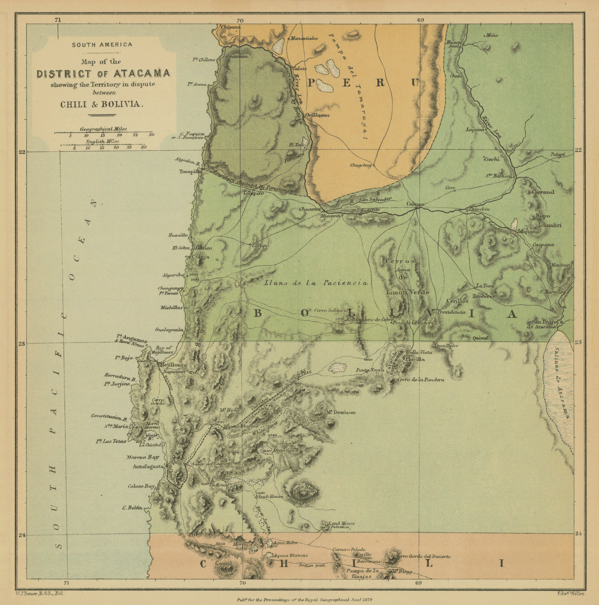

# Geografía y fronteras de 1879

Ficha histórica de la tarea **T-009** (propuesta P-002). Sirve de base para **T-010** (escala y coordenadas del mapa) y **T-011** (generar el mapa desde datos reales).

**Cómo leer la ficha**

- **Documentado:** hay consenso, o el dato viene del texto de un tratado o de una fuente primaria.
- **Discutido:** hay versiones distintas entre historiadores o entre los países. Se dan las versiones y quién las sostiene.
- **Pendiente:** no se pudo verificar en esta sesión. No se debe usar como dato firme hasta revisarlo.

Las coordenadas van en grados decimales, con latitud sur y longitud oeste negativas, en WGS84. Son de lugares actuales o de su ubicación histórica conocida. La columna **Precisión** indica:
- **A:** localidad que existe hoy con el mismo nombre y lugar. Error menor de unos 2 km.
- **B:** sitio histórico (campo de batalla, mineral, estación o caleta abandonada) ubicado de forma aproximada. Error posible de 5 a 10 km.

Las coordenadas son de conocimiento general y de nomenclátores modernos. Hay que contrastarlas con GeoNames u OpenStreetMap antes de fijarlas en T-011 (**pendiente**).

---

## 1. Mapa de referencia

*Map of the District of Atacama showing the Territory in dispute between Chili & Bolivia*, de W. J. Turner (dibujo) y Edward Weller (grabado). Se publicó en los *Proceedings of the Royal Geographical Society* en 1879. El archivo está en `docs/referencias/mapas/atacama_1879_turner_stanford.png` y su ficha en `docs/referencias/mapas/README.md`.

**Qué muestra (revisado en esta tarea):**

- **Zona:** de unos 21° 20′ S a 24° 20′ S y de 71° 15′ W a 68° 15′ W, con una cuadrícula cada 1°.
- **Colores:**
  - Perú en ocre, al norte del río Loa (Pampa del Tamarugal, Quillagua).
  - Bolivia en verde, desde el Loa hasta el paralelo 23° S. Entre los paralelos 23° y 24° S el verde es más claro: es la zona que el tratado de 1874 dejó boliviana pero con derechos compartidos.
  - Chile en rosado, al sur de 24° S.
- **Límites en disputa:**
  - *«Boundary claimed by Bolivia»* sube por el río Loa hasta Quillagua.
  - *«Boundary claimed by Peruvians»* va desde la costa, al sur de la desembocadura del Loa, hasta la zona de Colupito y Tocopilla. O sea, Perú reclamaba una franja al sur del Loa. Es un caso de límite discutido (ver 2.3).
- **Puertos y caletas:** Tocopilla, Cobija, Mejillones, Antofagasta y Caleta Coloso.
- **Interior:**
  - Calama, Chiu Chiu, San Pedro de Atacama, el Llano de la Paciencia, el mineral de plata de Caracoles y las minas de plomo de Palestina.
  - El Salar de Atacama aparece en el borde oriental.
- **Transporte:**
  - Un ferrocarril de Antofagasta al Salar del Carmen, que sigue hacia el interior por «Las Salinas».
  - Un tramo de vía rotulado *Railway* al sur de Mejillones.
  - Caminos y senderos («Indian path»).

**Puntos de control para georreferenciar el mapa.** Son los cruces de la cuadrícula del mapa, medidos a ojo sobre el PNG original de 3639 × 3672 px, con un error de ±3 px.

| Cruce | x (px) | y (px) |
|---|---|---|
| 71° W, 22° S | 364 | 920 |
| 70° W, 22° S | 1459 | 910 |
| 69° W, 22° S | 2550 | 908 |
| 71° W, 23° S | 386 | 2082 |
| 70° W, 23° S | 1467 | 2067 |
| 69° W, 23° S | 2549 | 2067 |
| 70° W, 24° S | 1472 | 3231 |
| 69° W, 24° S | 2544 | 3231 |

La cuadrícula no es perfectamente ortogonal en el escaneo. Por ejemplo, el meridiano 71° se desplaza unos 22 px entre 22° S y 23° S. Por eso conviene una transformación polinómica de primer o segundo orden (por ejemplo `gdal_translate -gcp` seguido de `gdalwarp -order 2`) y no un simple escalado.

Las longitudes de los mapas del siglo XIX pueden tener errores de algunos minutos. En una comparación rápida, Antofagasta y Mejillones caen a menos de unos 2′ de su posición real.

---

## 2. Fronteras en 1879

### 2.1 Chile y Bolivia: el paralelo 24° S

**Documentado: el tratado de 1866.** Fijó el límite en el paralelo 24° S. Creó además una zona de beneficios compartidos entre los paralelos 23° y 25° S: los dos países se repartían los ingresos del guano y los derechos de exportación de minerales.

**Documentado: el tratado del 6 de agosto de 1874.** Se firmó en Sucre. Lo firmaron Carlos Walker Martínez por Chile y Mariano Baptista por Bolivia. Tiene un protocolo complementario de 1875. Según el texto transcrito en Wikisource:

- **Art. I:** el límite es *«el paralelo del grado 24 desde el mar hasta la cordillera de los Andes»*, en el *divortia aquarum*.
- **Art. II:** se dan por válidas las líneas de los paralelos 23 y 24 fijadas por la comisión de 1870. Si hubiera dudas sobre la ubicación de un mineral, como Caracoles, resolverían dos peritos y, si no se ponían de acuerdo, el Emperador del Brasil.
- **Art. III:** los depósitos de guano entre los paralelos 23° y 25° S se siguen repartiendo por partes iguales.
- **Art. IV:** los derechos de exportación de minerales entre los paralelos 23° y 24° S no pueden superar los vigentes. Las personas, industrias y capitales chilenos no pagarán contribuciones nuevas. La cláusula *«durará por el término de veinticinco años»*.
- **Art. V:** hay libre internación recíproca de productos naturales: los de Chile por el litoral boliviano entre los paralelos 23° y 24° S, y los de Bolivia por el litoral chileno entre los paralelos 24° y 25° S.
- **Art. VI:** habilita los puertos de Mejillones y Antofagasta.
- **Art. VII:** deroga el tratado de 1866.

En resumen, en 1879 la costa boliviana iba desde la desembocadura del Loa (unos 21,43° S) hasta el paralelo 24° S. Mide unos 285 km en línea norte–sur y bastante más siguiendo la costa.

**Detonante, documentado.** Una ley boliviana de febrero de 1878 fijó un impuesto de 10 centavos por quintal de salitre exportado por la Compañía de Salitres y Ferrocarril de Antofagasta (CSFA). Chile lo consideró contrario al artículo IV. Bolivia sostuvo que era un asunto interno con una empresa concesionaria. Bolivia dispuso rematar los bienes de la compañía, y el 14 de febrero de 1879 Chile ocupó Antofagasta. La interpretación jurídica del impuesto sigue siendo **discutida** entre las historiografías de los tres países.

**Discutido: las reclamaciones anteriores a 1866.** Chile había reclamado hasta el paralelo 23° S. Bolivia había reclamado territorios más al sur, en la zona de Paposo, hacia los 25° S. Esto explica que el Pacto de Tregua de 1884 hable del paralelo 23 (ver 3).

### 2.2 Perú: Tarapacá y Tacna–Arica

- **Tarapacá, documentado.** Era peruana. Iba desde la quebrada de Camarones (unos 19,2° S) hasta el río Loa (unos 21,4° S). Era el centro del salitre: en 1875 el Estado peruano había expropiado las oficinas salitreras.
- **Tacna y Arica, documentado.** Eran peruanas. Iban desde la quebrada de Camarones hasta el río Sama, por el norte. Es la definición que usa el art. 3 del Tratado de Ancón.
- **Más al norte, documentado.** Seguían Moquegua (con el puerto de Ilo), Arequipa (con Mollendo) y la costa central hasta Lima y el Callao.

### 2.3 Perú y Bolivia: el río Loa

- **Documentado, en lo general.** El límite en la costa era el río Loa.
- **Discutido, en el detalle.** El mapa de Turner muestra dos trazados. Bolivia reclamaba que el límite subía por el Loa hasta Quillagua. Perú reclamaba una línea más al sur, que dejaba en territorio peruano una franja al sur de la desembocadura. No se ha verificado si había una línea acordada en el interior.

### 2.4 El límite oriental: la Puna de Atacama

- **Pendiente o no definido.** En 1879 el límite entre Bolivia y Argentina en la Puna de Atacama no estaba fijado. Hoy esa zona está en Chile y Argentina. Se resolvió en la década de 1890 (arbitraje de 1899).
- Para el juego basta saber que al este de la cordillera Occidental de los Andes, más o menos desde los 68° W, comenzaba el altiplano boliviano o una puna de soberanía imprecisa.

### 2.5 Alianza Perú–Bolivia

**Documentado.** El tratado secreto de alianza defensiva entre Perú y Bolivia se firmó el 6 de febrero de 1873. Chile declaró la guerra a Bolivia y a Perú el 5 de abril de 1879.

---

## 3. Cambios de frontera y control, 1879–1884

Las fechas son las más citadas. Las de batallas y ocupaciones están documentadas. El control de facto no siempre coincidió con el de jure.

| Fecha | Hecho | Efecto territorial |
|---|---|---|
| 14 feb 1879 | Chile ocupa Antofagasta | Control chileno del litoral entre 23° y 24° S |
| feb–mar 1879 | Ocupación de Mejillones, Caracoles, Cobija y Tocopilla | Toda la costa boliviana hasta el Loa |
| 23 mar 1879 | Combate de Topáter (Calama) | Chile controla el interior hasta Calama |
| 5 abr 1879 | Chile declara la guerra a Perú y Bolivia | Bloqueo de Iquique |
| 21 may 1879 | Combates navales de Iquique y Punta Gruesa | Se pierden la *Esmeralda* (Chile) y la *Independencia* (Perú) |
| 8 oct 1879 | Combate naval de Angamos | Se captura el *Huáscar*. Chile pasa a controlar el mar |
| 2 nov 1879 | Desembarco en Pisagua | Comienza la campaña de Tarapacá |
| 19 nov 1879 | Batalla de Dolores (San Francisco) | |
| 23 nov 1879 | Chile ocupa Iquique | |
| 27 nov 1879 | Batalla de Tarapacá, victoria peruana | El ejército aliado se retira a Arica y Tacna. Tarapacá queda bajo control chileno |
| feb–mar 1880 | Desembarco en Ilo/Pacocha y combate de Los Ángeles (22 mar) | Control de Moquegua |
| 26 may 1880 | Batalla del Alto de la Alianza (Tacna) | Bolivia se retira de la guerra activa |
| 7 jun 1880 | Asalto y toma del Morro de Arica | Control de Tacna y Arica |
| 13 y 15 ene 1881 | Batallas de Chorrillos (San Juan) y Miraflores | |
| 17 ene 1881 | Chile ocupa Lima | Comienza la ocupación |
| 1881–1883 | Campaña de la Breña, en la sierra central y del norte | Resistencia peruana; Chile no controla toda la sierra |
| 10 jul 1883 | Batalla de Huamachuco (unos 7,8° S) | Fin de la resistencia organizada principal |
| 20 oct 1883 | Tratado de Ancón | Perú cede Tarapacá a perpetuidad. Tacna y Arica quedan 10 años bajo Chile, con un plebiscito previsto |
| 4 abr 1884 | Pacto de Tregua con Bolivia, firmado en Valparaíso | Chile gobierna desde el paralelo 23 hasta la desembocadura del Loa. Bolivia queda sin costa de hecho |

**Después de la guerra (contexto, documentado):**

- El Tratado de 1904 con Bolivia fijó la soberanía chilena sobre el antiguo litoral boliviano.
- El plebiscito de Tacna y Arica nunca se hizo. El Tratado de Lima de 1929 devolvió Tacna a Perú y dejó Arica en Chile.

**Situación al cierre de 1884, para el mapa del juego:**

| Tramo | Situación |
|---|---|
| Valparaíso – 24° S | Chile, como antes de la guerra |
| 24° S – Loa | Bajo gobierno chileno por la tregua |
| Loa – Camarones (Tarapacá) | Chilena por el Tratado de Ancón |
| Camarones – Sama (Arica y Tacna) | Ocupación chilena con plebiscito pendiente |
| Al norte del Sama | Perú. Las tropas chilenas se retiraron de Lima en 1884 (**fecha exacta pendiente**) |

---

## 4. Extensión del teatro de operaciones

### 4.1 Caja de mapa propuesta

Cubre de Callao a Valparaíso y de la costa al altiplano.

| Límite | Valor | Referencia |
|---|---|---|
| Norte | 11,5° S | Al norte de Ancón y el Callao (12,05° S) |
| Sur | 33,5° S | Al sur de Valparaíso (33,05° S) y Santiago (33,45° S) |
| Oeste | 78,0° W | Al oeste del Callao (77,15° W), con mar para el combate naval |
| Este | 67,0° W | Altiplano: Oruro (67,1° W). La cordillera Occidental está entre 68° y 69,5° W |

**Medidas** (calculadas con la fórmula de haversine y una Tierra de radio 6371 km):

- **Norte–sur:** 22° de latitud, unos **2 450 km**.
- **Este–oeste:** 11° de longitud, entre **1 200 km** a 12° S y **1 025 km** a 33° S. Mide unos 1 160 km a 18° S y 1 120 km a 24° S.

**Con la escala 1:20 elegida en Q-001 (T-010)**, esta caja quedaría en unos **122 × 51–60 km** de juego. Coincide con los «unos 125 km» del mapa continuo, siempre que el lado largo sea el eje norte–sur.

La guerra en tierra se concentró en una franja costera de 50 a 200 km de ancho. Casi todo el resto de la caja es mar, desierto o cordillera.

### 4.2 Núcleo de las campañas de 1879–1880

Va de Antofagasta a Tacna y Moquegua:

- **Latitud:** de 17,0° S a 24,5° S, unos **835 km** norte–sur.
- **Longitud:** de 71,5° W a 67,5° W, unos **415 km** este–oeste a 21° S.

### 4.3 Fuera de la caja (ver licencias creativas, sección 9)

- **Campaña de la Breña (1881–1883):** se libró en la sierra central y del norte del Perú. Huamachuco está a 7,81° S y 78,05° W, y hubo operaciones en Junín, Cajamarca y otros lugares, al norte y al este del límite.
- **Correrías navales:** la corbeta peruana *Unión* llegó en 1879 hasta Punta Arenas (unos 53° S). El *Huáscar* operó a lo largo de la costa chilena al sur de Antofagasta. Los puntos exactos de sus incursiones están **pendientes** de verificar.

### 4.4 Distancias de referencia en línea recta

| Tramo | km |
|---|---|
| Callao – Valparaíso | 2 400 |
| Callao – Arica | 1 020 |
| Antofagasta – Valparaíso | 1 050 |
| Antofagasta – Iquique | 380 |
| Iquique – Arica | 195 |
| Pisagua – Iquique | 70 |
| Arica – Tacna | 53 |
| Ilo – Tacna | 120 |
| Antofagasta – Calama | 200 |
| Antofagasta – Mejillones | 61 |

Las distancias por mar siguiendo la costa son algo mayores.

---

## 5. Lugares con coordenadas

### 5.1 Perú

| Lugar | Tipo | Lat | Lon | Prec. | Nota |
|---|---|---|---|---|---|
| Ancón | Puerto | -11.773 | -77.176 | A | Lugar del Tratado de Ancón, 1883 |
| Callao | Puerto principal y base naval | -12.056 | -77.146 | A | Bloqueado por Chile en 1880 |
| Lima | Capital | -12.046 | -77.043 | A | Ocupada el 17 ene 1881 |
| Chorrillos | Balneario y batalla | -12.169 | -77.024 | A | 13 ene 1881 |
| Miraflores | Batalla | -12.121 | -77.030 | A | 15 ene 1881 |
| Pisco | Puerto | -13.710 | -76.204 | A | Desembarco chileno de 1880 |
| Puno | Ciudad del lago Titicaca | -15.840 | -70.022 | A | Final del ferrocarril del Sur |
| Arequipa | Ciudad | -16.399 | -71.537 | A | |
| Mollendo | Puerto | -17.024 | -72.015 | A | Comienzo del ferrocarril a Arequipa |
| Moquegua | Ciudad | -17.194 | -70.935 | A | |
| Los Ángeles | Batalla (cuesta) | -17.10 | -70.90 | B | 22 mar 1880, al norte de Moquegua |
| Ilo / Pacocha | Puerto | -17.640 | -71.340 | A | Desembarco chileno de 1880 |
| Tacna | Ciudad | -18.013 | -70.251 | A | |
| Alto de la Alianza (Intiorko) | Batalla | -17.97 | -70.27 | B | 26 may 1880, al norte de Tacna |
| Arica | Puerto y Morro | -18.478 | -70.321 | A | 7 jun 1880 |
| Pisagua | Puerto salitrero | -19.597 | -70.212 | A | Desembarco del 2 nov 1879 |
| Dolores / cerro San Francisco | Batalla | -19.63 | -69.97 | B | 19 nov 1879, cerca de Zapiga |
| Tarapacá | Pueblo en la quebrada | -19.920 | -69.510 | A | Batalla del 27 nov 1879 |
| Iquique | Puerto salitrero principal | -20.214 | -70.152 | A | Combate naval del 21 may 1879 |
| Punta Gruesa | Punta costera | -20.36 | -70.18 | B | Varada de la *Independencia* |
| Pozo Almonte | Pueblo de la pampa | -20.256 | -69.786 | A | |
| La Noria | Cantón salitrero | -20.38 | -69.86 | B | Fin de la vía férrea desde Iquique |
| Pabellón de Pica | Covadera de guano | -20.87 | -70.14 | B | |
| Huanillos | Covadera de guano | -21.27 | -70.10 | B | |
| Desembocadura del Loa | Límite Perú–Bolivia | -21.428 | -70.058 | A | |
| Quillagua | Oasis en el Loa | -21.650 | -69.540 | A | Hasta aquí llegaba el límite que reclamaba Bolivia |

### 5.2 Litoral boliviano y Atacama

| Lugar | Tipo | Lat | Lon | Prec. | Nota |
|---|---|---|---|---|---|
| Tocopilla | Puerto (cobre) | -22.092 | -70.198 | A | |
| Cobija (Puerto La Mar) | Puerto histórico | -22.555 | -70.262 | A | Hoy son ruinas. Había decaído tras el terremoto y maremoto de 1877 |
| Calama | Oasis y ciudad | -22.456 | -68.925 | A | Combate de Topáter, 23 mar 1879 |
| Chiu Chiu | Pueblo | -22.340 | -68.650 | A | |
| San Pedro de Atacama | Pueblo | -22.911 | -68.200 | A | |
| Caracoles | Mineral de plata | -23.03 | -69.03 | B | En la zona entre 23° y 24° S. Turner lo ubica cerca de 23° 05′ S y 69° 02′ W |
| Punta Angamos | Punta | -23.020 | -70.515 | A | El combate de Angamos fue mar adentro, frente a esta punta |
| Mejillones | Puerto (guano) | -23.100 | -70.450 | A | Habilitado por el tratado de 1874 |
| Salar del Carmen | Salitrera y estación de la CSFA | -23.6 | -70.2 | B | **Pendiente:** Turner lo dibuja unos 0,28° al este de Antofagasta; las fuentes modernas lo ponen más cerca de la costa |
| Antofagasta | Puerto | -23.650 | -70.400 | A | La ocupación del 14 feb 1879 inicia la guerra |
| Paralelo 24° S en la costa | Límite Chile–Bolivia | -24.000 | -70.53 | A | Cerca de caleta Coloso y Punta Jara, al sur de Antofagasta |

### 5.3 Chile

| Lugar | Tipo | Lat | Lon | Prec. | Nota |
|---|---|---|---|---|---|
| Taltal | Puerto | -25.405 | -70.485 | A | |
| Chañaral | Puerto (cobre) | -26.345 | -70.620 | A | |
| Caldera | Puerto | -27.067 | -70.820 | A | Ferrocarril a Copiapó |
| Copiapó | Ciudad | -27.366 | -70.332 | A | |
| Coquimbo | Puerto | -29.953 | -71.343 | A | |
| La Serena | Ciudad | -29.904 | -71.248 | A | |
| Valparaíso | Puerto principal y base naval | -33.047 | -71.620 | A | Lugar del Pacto de Tregua, 1884 |
| Santiago | Capital | -33.449 | -70.669 | A | |

### 5.4 Bolivia interior (no fue escenario de combates)

| Lugar | Lat | Lon | Prec. | Nota |
|---|---|---|---|---|
| La Paz | -16.500 | -68.150 | A | Sede frecuente del gobierno |
| Oruro | -17.970 | -67.110 | A | |
| Potosí | -19.583 | -65.753 | A | |
| Sucre | -19.048 | -65.260 | A | Capital oficial |

### 5.5 Fuera de la caja

| Lugar | Lat | Lon | Nota |
|---|---|---|---|
| Huamachuco | -7.812 | -78.049 | Batalla del 10 jul 1883 |
| Punta Arenas | -53.16 | -70.91 | Llegada de la corbeta *Unión* en 1879 |

---

## 6. Relieve, agua y obstáculos al movimiento

### 6.1 Franjas de oeste a este

Valen sobre todo entre los 17° y los 27° S.

1. **Cordillera de la Costa.**
   - En gran parte cae al mar en un acantilado de 500 a 1 000 m o más, sin playa útil.
   - Los puertos (Iquique, Pisagua, Tocopilla, Cobija, Antofagasta) son caletas al pie de ese acantilado. Subir de la costa a la pampa obliga a usar cuestas o el ferrocarril.
   - En la costa es frecuente la neblina costera (*camanchaca*).
2. **Depresión intermedia o pampa**, a 1 000–1 500 m de altura.
   - En Tarapacá es la **Pampa del Tamarugal**, con bosques de tamarugo y agua subterránea poco profunda. Allí estaban las salitreras.
   - En Antofagasta están el **Llano de la Paciencia** y las pampas salitreras.
   - Es desierto absoluto: el **desierto de Atacama**, uno de los más áridos del mundo.
3. **Precordillera y cordillera de los Andes** (cordillera Occidental).
   - Tiene volcanes de más de 5 000 m. Los pasos están sobre los 4 000 m.
   - Más al este está el **altiplano**, a 3 700–4 000 m: Bolivia y el sur del Perú.
4. **Más al norte de Arequipa** la costa es menos abrupta, con valles fértiles transversales (Lima, Pisco, Ica). Siguen siendo desiertos costeros, pero con oasis.

### 6.2 El agua decide el movimiento (documentado)

En el desierto no hay agua salvo en los ríos que bajan de los Andes, las quebradas y los pozos o aguadas. Los ejércitos se movían de una fuente de agua a la siguiente y dependían de máquinas desalinizadoras («resacadoras») en la costa. La sed y el transporte de agua causaron muchas bajas y marcaron la campaña de Tarapacá.

### 6.3 Ríos y quebradas, de sur a norte

| Curso | Desembocadura aprox. (lat, lon) | Importancia |
|---|---|---|
| Río Aconcagua | -32.92, -71.51 | Valle de Valparaíso y Santiago |
| Río Elqui | -29.89, -71.27 | La Serena |
| Río Copiapó | -27.33, -70.95 | Valle de Copiapó |
| Río Loa | -21.43, -70.06 | El único río que cruza el desierto de Atacama hasta el mar. Pasa por Calama, Chiu Chiu y Quillagua. Era el límite Perú–Bolivia |
| Quebrada de Tarapacá | No llega al mar (se pierde en la pampa) | Pueblo de Tarapacá, batalla del 27 nov 1879 |
| Quebrada de Tana o Tiliviche | -19.6 (Pisagua) | Su desembocadura está cerca de Pisagua |
| Quebrada de Camarones | -19.20, -70.27 | Límite sur de Arica y Tacna (Ancón) |
| Quebrada de Vítor (Chaca) | -18.75, -70.34 | |
| Valle de Azapa / río San José | -18.48, -70.32 (Arica) | Agua para Arica |
| Río Lluta | -18.41, -70.32 | |
| Río Sama | -17.83, -70.88 (aprox.) | Límite norte de Tacna y Arica (Ancón). **Coordenada pendiente** |
| Río Locumba | -17.9, -70.9 (aprox.) | **Coordenada pendiente** |
| Río Osmore / Moquegua | -17.64, -71.34 (Ilo) | |
| Río Tambo | -17.18, -71.85 (aprox.) | |
| Río Rímac | -12.03, -77.13 (Callao) | Lima |
| Río Lurín | -12.28, -76.90 (aprox.) | Al sur de Lima, en la línea de defensa de 1881 |

### 6.4 Salares y desiertos con nombre

- **Desierto de Atacama:** entre unos 18° y 27° S.
- **Pampa del Tamarugal:** una franja norte–sur entre unos 19,5° y 21,5° S, cerca de los 69,5–69,9° W.
- **Llano de la Paciencia:** entre Cobija y Calama, cerca de los 22,8° S.
- **Salar de Atacama:** cerca de los 23,5° S y 68,25° W.
- **Salar del Carmen:** cerca de Antofagasta.

---

## 7. Recursos: salitre, guano y plata

- **Salitre de Tarapacá (Perú), documentado.**
  - Cantones de Zapiga y Negreiros, al interior de Pisagua; La Noria, Pozo Almonte y Lagunas, al interior de Iquique.
  - Perú estableció el estanco del salitre en 1873 y expropió las oficinas en 1875.
- **Salitre de Antofagasta (Bolivia), documentado.**
  - Salar del Carmen, de la CSFA, con capitales chilenos y británicos. Es la empresa del impuesto de los 10 centavos.
- **Guano, documentado.**
  - Mejillones, en la zona compartida por el tratado.
  - Pabellón de Pica, Huanillos y Punta de Lobos, en Tarapacá.
  - Las islas de Chincha, frente a Pisco, ya casi agotadas en la década de 1870.
- **Plata, documentado.** Caracoles, descubierto hacia 1870. La disputa sobre si estaba al norte o al sur del paralelo 23 motivó el art. II del tratado de 1874.
- **Cobre.** Tocopilla y Chañaral.

---

## 8. Ferrocarriles y caminos hacia 1879

**Advertencia.** Las fechas de inauguración y la longitud de varias líneas en 1879 varían según la fuente. Lo que no está marcado como documentado debe verificarse en literatura ferroviaria antes de fijarlo en el juego.

| Línea | País en 1879 | Estado en 1879 | Fiabilidad |
|---|---|---|---|
| Callao – Lima | Perú | Operando desde 1851. Es el primer ferrocarril de Sudamérica | Documentado |
| Lima – Chorrillos | Perú | Operando desde 1858 | Documentado |
| Lima – Ancón (y Chancay) | Perú | Operando en la década de 1870 | Fecha exacta **pendiente** |
| Ferrocarril Central (Callao – La Oroya) | Perú | En construcción. Llegaba hasta la zona de Chicla | **Pendiente** |
| Pisco – Ica | Perú | Operando | Fecha **pendiente** |
| Mollendo – Arequipa – Puno | Perú | Mollendo–Arequipa hacia 1871 y extensión a Puno hacia 1876 | Probable; verificar |
| Ilo – Moquegua | Perú | Operando, unos 100 km | Fecha **pendiente** |
| Arica – Tacna | Perú | Operando desde la década de 1850, unos 60 km | Documentado en lo general; año exacto **pendiente** |
| Pisagua – interior (Zapiga, Dolores) | Perú | Operando. Fue clave en el desembarco de Pisagua | Trazado y fechas **pendientes** |
| Iquique – La Noria (y ramales) | Perú | Operando desde hacia 1871 (concesión de 1860) | Probable; verificar |
| Patillos – interior | Perú | Existía una línea salitrera | **Pendiente** |
| Antofagasta – Salar del Carmen – Salinas | Bolivia (empresa CSFA) | Iniciado en 1873, con locomotoras desde 1876. En 1879 llegaba unos 100–150 km al interior; el tramo hasta el Salar del Carmen tiene unos 35 km. El mapa de Turner lo dibuja hasta más allá del Salar del Carmen. **No llegaba a Calama** (llegó en la década de 1880) | Inicio documentado; extremo en 1879 **pendiente** |
| Mejillones – Caracoles | Bolivia | Proyectado y construido solo en parte. El mapa de Turner muestra un tramo al sur de Mejillones | **Pendiente** |
| Caldera – Copiapó | Chile | Operando desde 1851 | Documentado |
| Coquimbo – La Serena | Chile | Operando | Fecha **pendiente** |
| Valparaíso – Santiago | Chile | Operando desde 1863 | Documentado |

**Bolivia interior.** Hasta donde se pudo revisar, en 1879 no había ferrocarriles dentro del altiplano boliviano. El acceso al mar era por Cobija y Antofagasta en su litoral, o por Arica y Mollendo en Perú. Es **pendiente** confirmarlo.

**Caminos, en general:**

- **Altiplano – costa.** Eran caminos de herradura para recuas de mulas y llamas, con postas y aguadas:
  - Potosí – Calama – Cobija o Antofagasta.
  - La Paz – Tacna – Arica.
  - Oruro – Tarapacá.
- **En el desierto.** Las «rutas» eran sendas entre pozos. El mapa de Turner marca caminos y un «Indian path» al sur de 24° S.
- **En la costa sur.** La comunicación principal entre puertos era por mar.
- **En el Perú central.** El Camino Real o red colonial unía Lima con la costa sur y la sierra.

Para el juego, estas vías se pueden tratar como caminos de baja velocidad. Las rutas exactas son **pendientes**.

---

## 9. Licencias creativas a decidir

La ficha no toma estas decisiones. Quedan registradas como preguntas para Feño, responsable de historia: **Q-006** (caja del mapa) y **Q-007** (límites ambiguos). Las dos bloquean T-011. Cuando se respondan, se registrarán como decisiones del área historia.

1. **Caja del mapa.** La caja propuesta (11,5–33,5° S, 78–67° W) deja fuera la campaña de la Breña (hasta unos 7,8° S, en la sierra) y la correría de la *Unión* a Punta Arenas. Las opciones son:
   - extender el mapa;
   - representar esas operaciones fuera del mapa continuo;
   - omitirlas.
2. **Límites ambiguos.** El juego necesita un solo trazado donde la historia tiene varios:
   - el límite Perú–Bolivia en el Loa, con las dos versiones del mapa de Turner;
   - el límite oriental de Bolivia en la Puna, que no estaba definido.

   Una propuesta neutral sería usar la desembocadura del Loa y el curso bajo del río, y la divisoria de aguas andina como límite oriental. El juego debería indicar que es una simplificación.

---

## Fuentes

**Consultadas en esta tarea**

- Turner, W. J. (dibujo) y Weller, E. (grabado). *Map of the District of Atacama showing the Territory in dispute between Chili & Bolivia*. *Proceedings of the Royal Geographical Society*, 1879. Princeton University Library, Digital Maps: https://maps.princeton.edu/catalog/princeton-4f16c534z (copia local en `docs/referencias/mapas/`).
- *Tratado de límites de 1874 entre Bolivia y Chile* (Sucre, 6 de agosto de 1874), transcripción en Wikisource: https://es.wikisource.org/wiki/Tratado_de_l%C3%ADmites_de_1874_entre_Bolivia_y_Chile
- *Tratado de Ancón* (20 de octubre de 1883), texto en español e inglés. Dirección Nacional de Fronteras y Límites del Estado (Difrol), Chile: https://controversiasinternacionales.difrol.cl/wp-content/uploads/2023/09/1883.10.20.-Tratado-de-Ancon-entre-Chile-y-Peru.-Espanol-e-Ingles.pdf . Reproducido también en los alegatos del caso *Obligación de negociar un acceso al océano Pacífico* (Bolivia c. Chile) ante la Corte Internacional de Justicia: https://api.icj-cij.org/sites/default/files/case-related/153/153-20140715-wri-01-01-en.pdf
- *Pacto de Tregua entre Chile y Bolivia* (Valparaíso, 4 de abril de 1884), transcrito en *Cuadernos de Historia*, Universidad de Chile: https://cuadernosdehistoria.uchile.cl/index.php/CDH/article/download/47282/49325/167571
- «Ferrocarril de Antofagasta a Bolivia», Wikipedia (en inglés). Sirvió para el inicio de las obras en 1873 y las locomotoras desde 1876. La cifra de unos 150 km en 1879 no tiene cita en el artículo: https://en.wikipedia.org/wiki/Ferrocarril_de_Antofagasta_a_Bolivia
- Memoria Chilena, Biblioteca Nacional de Chile, «Antofagasta (1845-2006)»: https://www.memoriachilena.gob.cl/602/w3-article-3296.html
- «Agua Santa nitrate railway», Wikipedia (en inglés). Sirvió para la concesión de 1860 de Iquique a La Noria y para fechar la línea de Agua Santa en 1889–1890, posterior a la guerra: https://en.wikipedia.org/wiki/Agua_Santa_nitrate_railway

**Obras de referencia para verificar lo pendiente** (no se consultaron en esta sesión)

- Bulnes, Gonzalo. *Guerra del Pacífico*. 3 vols. Valparaíso, 1911–1919. Visión chilena clásica.
- Basadre, Jorge. *Historia de la República del Perú*. Visión peruana.
- Querejazu Calvo, Roberto. *Guano, salitre, sangre*. La Paz, 1979. Visión boliviana.
- Sater, William F. *Andean Tragedy: Fighting the War of the Pacific, 1879–1884*. University of Nebraska Press, 2007.
- Farcau, Bruce W. *The Ten Cents War: Chile, Peru, and Bolivia in the War of the Pacific, 1879–1884*. Praeger, 2000.
- Paz Soldán, Mateo. *Atlas geográfico del Perú*. París, 1865. Cartografía peruana de la época.
- Para las coordenadas: GeoNames (https://www.geonames.org) y OpenStreetMap.

## Pendientes

- [ ] Verificar las coordenadas de tipo B, sobre todo Salar del Carmen, Dolores, La Noria, Los Ángeles y el Alto de la Alianza, y las desembocaduras del Sama, el Locumba y el Tambo.
- [ ] Verificar la extensión de cada ferrocarril en febrero de 1879, en especial Antofagasta, Pisagua, Iquique y Mejillones.
- [ ] Fijar los puntos exactos de las incursiones del *Huáscar* en 1879.
- [ ] Fijar la fecha de la evacuación chilena de Lima en 1884.
- [ ] Afinar los puntos de control del mapa de Turner con un programa SIG.
